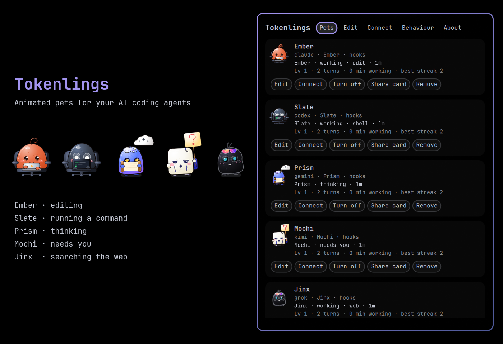
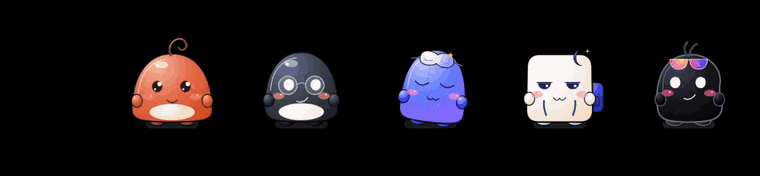

# Tokenlings

Animated pets for your AI coding agents, living in the Omarchy bar. One pet per account, any provider. They work when your agent works, wave when it needs you, celebrate when it finishes, and play together the rest of the time.





## What they do

- **React to real agent activity:** thinking, editing files, running commands, reading, browsing, spawning subagents, waiting for your permission, compacting context, finishing a task.
- **Get your attention without nagging:** a pet that needs you waves, then holds up a sign, and the other pets turn and point at it. Click it to jump to that agent's terminal.
- **Any number of accounts:** two Claude Code accounts, several Codex homes, Gemini, Grok, Kimi and more, each with its own pet. Siblings of the same agent get their own colours and accessory, so you can tell them apart at a glance.
- **Fully customisable:** body, eyes, mouth, hair, accessories, colours (or follow your Omarchy theme), personality and signature move. Every provider starts from its own base form.
- **A social life:** high-fives when two agents finish together, cheer squads, chases, catch, naps in a pile.
- **Roaming:** strolls and zoomies along the bar (they hop over the other widgets and sit on its edge), drag-and-fling physics, and, if you turn it on, short trips onto your windows.
- **Battery-aware:** no animation frames while resting, calm idle animation, and an automatic Battery mode on battery power (no roaming).
- **Private:** no network access, no credentials, and it never stores your prompts or code.

## Supported agents

| Agent | How the pet knows | What it shows | Verified |
|---|---|---|---|
| Claude Code | Lifecycle hooks (opt-in) | Everything: working, tool type, needs you, done | Live, two accounts |
| Codex CLI | Lifecycle hooks (opt-in) | Everything | Live hook events; the full flow against recorded sessions |
| Grok Build | Lifecycle hooks (opt-in) | Everything | Live, two Grok homes (against a local test model) |
| Kimi Code | Lifecycle hooks (opt-in) | Everything | Live (against a local test model) |
| Muse | Lifecycle hooks (opt-in) | Everything | Live (its offline echo provider) |
| Gemini CLI | Lifecycle hooks (opt-in) | Everything | Recorded sessions only |
| OpenCode | Plugin (opt-in) | Everything | Recorded sessions only |
| Other terminal agents | Process activity (`process:<regex>`) | Busy or idle | Tests |
| Desktop and web apps (ChatGPT, Claude, Antigravity, …) | Window presence (`window:<regex>`) | Asleep, awake or watching you (for browsers, only the active tab's title is visible) | Tests |

"Live" means a real session of that CLI drove the pet on the test machine (Omarchy 4.5.0rc1, Quickshell 0.3.2, Hyprland 0.56.2). "Recorded sessions" means the adapter is tested against hook payloads recorded from that CLI, but no live session was run.

## Requirements

Omarchy 4 (Quattro) with `omarchy-shell`. Nothing else to install: at runtime Tokenlings uses only what Omarchy ships (Quickshell, `sh`, coreutils, `jq`, `hyprctl`).

## Install

```sh
omarchy plugin add https://github.com/Aryaveer2103/tokenlings.git --enable
```

On first run the Tokenlings panel opens on **Welcome**. It looks for agent accounts and suggests one pet for each. Creating them writes only `~/.config/tokenlings/pets.json`. Connecting an agent is a separate yes, per agent, after you have seen the change.

Move it on the bar:

```sh
omarchy bar move io.github.aryaveer2103.tokenlings --section right
```

## Connect an agent

Open the Tokenlings panel (right-click a pet, or click the slot beside them), go to **Connect**, pick the pet and press **Install hooks…**. You see the exact file and the change before anything is written. A backup is saved to `~/.local/state/tokenlings/backups/`. **Send a test event** plays a short pretend session so you can see the pet react.

From a terminal:

```sh
alias tokenlings="$HOME/.config/omarchy/plugins/io.github.aryaveer2103.tokenlings/bin/tokenlings"
tokenlings hooks install claude --pet ember
tokenlings hooks status
```

### Codex asks once per account

Codex runs a new hook only after you trust it. After installing, start Codex for that account (`codex`, or `CODEX_HOME=~/.codex-work codex` for another one), type `/hooks` and trust the Tokenlings entries. Welcome and Connect remind you, and `tokenlings doctor` lists any account whose Tokenlings hooks are not trusted yet. Tokenlings only ever appends to `hooks.json`, so hooks you trusted before stay trusted.

### Grok and Claude Code on the same machine

Grok Build also runs the hooks in `~/.claude/settings.json` (its Claude compatibility is on by default), so without care a Grok session would wake your Claude pet too. Tokenlings handles this: Grok tells every hook it runs who called it, and the Claude pet ignores those events. Grok's own pet gets them through its own hook file. Nothing to configure.

## Several accounts of the same agent

Each account gets its own pet. Welcome finds them for you, and later the **Pets** tab offers any account it has not seen before (**New account found: add a pet?**). Nothing is written until you say yes. It looks in two places:

- folders: the default one (`~/.claude`, `~/.codex`, `~/.grok`, `~/.gemini`, `~/.kimi-code`, `~/.config/opencode`, `~/.config/muse`) and the patterns `~/.<folder>-*` and `~/.config/<agent>-*` (`~/.claude-work`, `~/.config/codex-2` …), if they hold that agent's files;
- agents that are running right now: the account variable they were started with (`CLAUDE_CONFIG_DIR`, `CODEX_HOME`, `GROK_HOME`, `KIMI_CODE_HOME`, `GEMINI_CLI_HOME`, `OPENCODE_CONFIG_DIR`, or `XDG_CONFIG_HOME` for Muse). Only those variables are kept; shell startup files are never read.

The first account of an agent keeps the pure base form. Every other one gets a different look, chosen from its account folder (so it comes back the same after a reinstall): shifted colours, an accessory of its own and a nudge to one personality trait. Its name comes from the folder: `~/.claude-work` becomes **Ember Work**, `~/.config/codex-2` **Slate 2**. Change anything you like in **Edit**; **Pure base form** turns the sibling look off.

From a terminal:

```sh
tokenlings add work --provider claude --config-dir ~/.claude-work
tokenlings hooks install claude --pet work --config-dir ~/.claude-work
```

How each event finds its pet: every agent names its account in its environment (`CLAUDE_CONFIG_DIR` and so on). The hooks in one account's folder carry that folder, so a session on another account never wakes this account's pet. That matters for Claude Code, which loads `~/.claude/settings.json` as project settings in any session started in your home folder, whichever account it runs. Where one hook location serves several accounts (OpenCode's global plugin), the hook looks the account up in `pets.json` and hands the event to the pet on that account. Grok reads its hooks from `$GROK_HOME/hooks`, so each Grok home gets its own small hook file.

## Customise

Use the **Edit** tab in the panel, or edit `~/.config/tokenlings/pets.json` (changes apply live; a broken file keeps the last good one in use and tells you once). With several monitors, a pet's **Lives on** setting picks its bar. Share a design with a friend:

```sh
tokenlings export ember      # prints a tkl1:… code
tokenlings import 'tkl1:…'
```

## Modes

| Mode | When | What changes |
|---|---|---|
| Show-off | You choose it | Smoothest animation, livelier idle antics, desktop trips even on battery |
| Balanced | Default on AC power | Bar roaming, desktop trips if you turned them on, regular idle antics |
| Battery | Default on battery | Lower frame rate, no roaming, pets sleep sooner |
| Still | You choose it | Pose changes only |

Roaming (stay home, along the bar, or bar and desktop trips), reduced motion, quiet hours, notifications and the rest are in **Behaviour**.

## Command line

```
tokenlings list | add | edit | rename | remove
tokenlings hooks install | uninstall | status
tokenlings doctor
tokenlings demo [--state STATE] [--pet PET] [--seed N]
tokenlings export | import
tokenlings uninstall [--purge]
```

`tokenlings help` explains each one. Add `--json` to any command for machine-readable output.

## Privacy and permissions

- No network access, no credentials, no root privileges, no packages, no services.
- Reads: its own config; small hook event files; `/proc` for agent process activity (only for pets that follow a process); the account variables of your running agents when it looks for accounts (first run, the Pets tab, **Find my agents**); Hyprland window and workspace state; battery and media-player status. Every file read is a regular file of yours with a size cap.
- Writes: `~/.config/tokenlings/`, `~/.local/state/tokenlings/`, `$XDG_RUNTIME_DIR/tokenlings/`, and your agents' hook settings **only** when you approve a hook install.
- Hook events record the event type, the kind of tool, a hashed session id, process ids and the name of the project folder (shown in tooltips only if you turn that on). Prompts, tool input and output, file contents and full paths are never stored.

See [SECURITY.md](SECURITY.md) for the full list.

## Update

```sh
omarchy plugin update io.github.aryaveer2103.tokenlings
```

## Remove

1. Remove the agent hooks, and optionally your pets and stats:

   ```sh
   tokenlings uninstall          # removes hooks only
   tokenlings uninstall --purge  # also deletes ~/.config/tokenlings, ~/.local/state/tokenlings and $XDG_RUNTIME_DIR/tokenlings
   ```

2. Remove the plugin:

   ```sh
   omarchy plugin remove io.github.aryaveer2103.tokenlings
   ```

If you removed the plugin first, your agents keep working: every hook checks that Tokenlings still exists before running. To clean up by hand, delete the entries that mention `tokenlings-hook` from your agents' settings files (and `tokenlings.json` from Grok's hooks folder, `tokenlings.js` from OpenCode's plugins folder); the originals are in `~/.local/state/tokenlings/backups/`.

## Troubleshooting

- `tokenlings doctor` checks config, hooks and permissions (including Codex trust) and says what to fix.
- Shell logs: `qs log -p "$OMARCHY_PATH/shell" --tail 100`
- A pet never wakes up: run `tokenlings hooks status`, then `tokenlings demo --state tool.edit --pet <id>` to confirm the pet itself works, or use **Send a test event** in the panel.
- Two pets react to one session: reinstall the hooks of both accounts (**Connect → Install hooks…**) so each hook knows its account folder.

## Disclaimer

Tokenlings is an independent project. It is not affiliated with or endorsed by Anthropic, OpenAI, Google, Moonshot AI, xAI, DeepSeek, the OpenCode project, Omarchy or 37signals. Product names describe compatibility only; all pet artwork is original.

## License

MIT, see [LICENSE](LICENSE).
